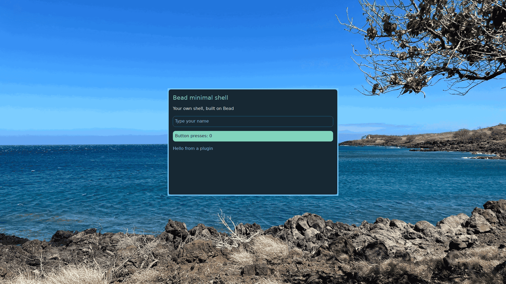

# Bead

Bead is an MIT-licensed Rust framework for building Wayland shells. Write a bar, panel or window as a `bead.toml` and a few Luau files; Bead provides rendering, input, layer-shell surfaces, reusable widgets and optional desktop services. Edits reload live: Bead validates the complete new view before swapping it in, so a broken edit keeps the last working UI and reports its file and line.

Bead is independent of any one desktop. Applications built on it supply their own identity, shell content, assets, configuration, service routes and installation policy.

**Status:** actively developed. The crates are not published to crates.io; applications pin a reviewed Git revision, and APIs may change between revisions.


*The minimal shell example running on Bead.*

## Get started

Build the `bead` CLI from this checkout, then run a folder app in your Wayland session:

```sh
cargo build --release --locked -p bead-cli
target/release/bead run examples/hello-bar
```

The build needs the Rust toolchain from `rust-toolchain.toml` and the system packages installed by the first step of [CI](.github/workflows/ci.yml). Put `target/release/bead` on your `PATH` to use `bead` as the docs do. `bead check examples/hello-bar` validates and renders an app on the CPU without a compositor; `bead run <folder> --seconds N` exits after N seconds.

Then build a bar in 15 minutes with the [bar tutorial](docs/tutorial/bar.md).

## Learn more

- [Documentation index](docs/README.md): tutorials, references, decisions and specifications.
- [Example gallery](examples/README.md), including the standalone Rust host in [`examples/minimal-shell`](examples/minimal-shell/README.md).
- [Framework crates](crates/README.md).
- [Contributing](CONTRIBUTING.md) and [security policy](SECURITY.md).

## License

Bead is licensed under the MIT License; see [`LICENSE`](LICENSE). Third-party components keep their own notices and licenses under `vendor/` and `crates/bead-test/fonts/`.
