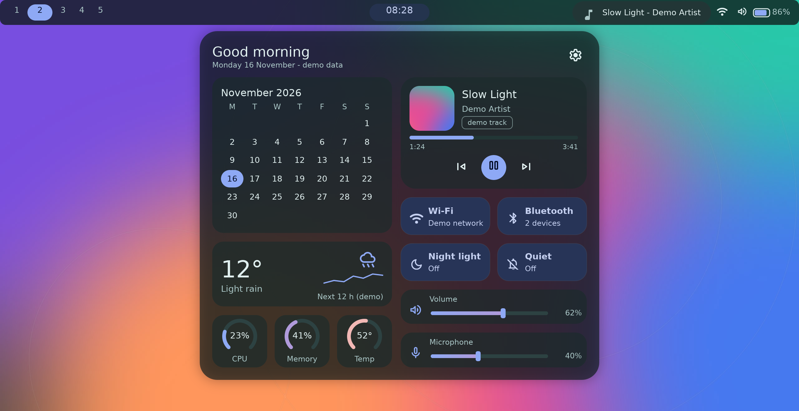
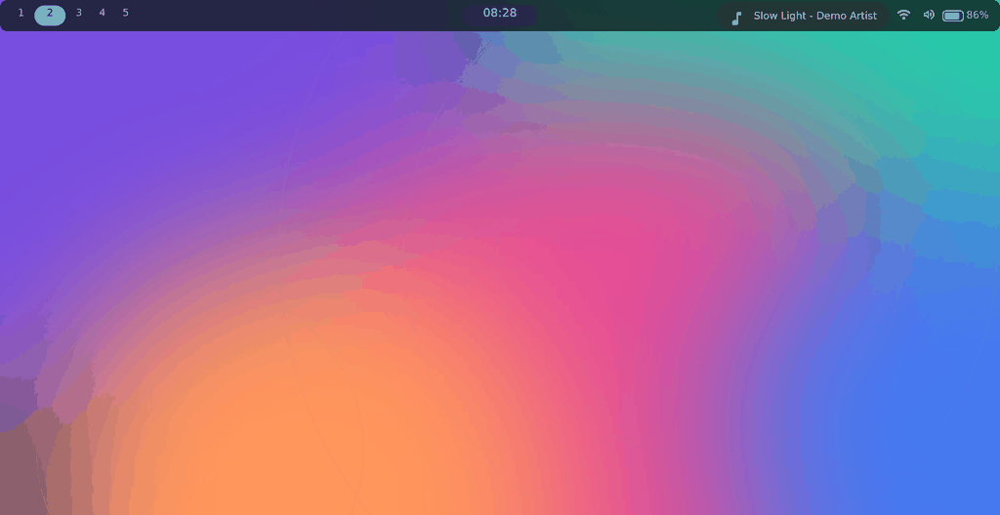
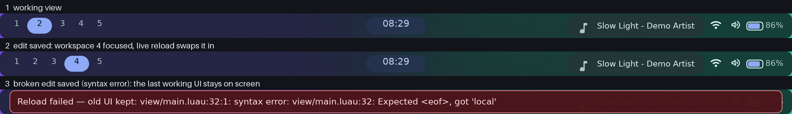

# Bead


*[`examples/showcase`](examples/showcase/README.md) running on Bead in a private headless Wayland session at output scale 2 (cropped to the bar and panel). Everything except the clock is demo data; the wallpaper is generated, and the palette is picked from it.*

Bead is an MIT-licensed Rust framework for building Wayland shells. Write a bar, panel or window as a `bead.toml` and a few Luau files; Bead provides rendering, input, layer-shell surfaces, reusable widgets and optional desktop services. Edits reload live: Bead validates the complete new view before swapping it in, so a broken edit keeps the last working UI and reports its file and line.

- **Luau views and `bead.toml`:** a folder app is a manifest plus Luau files, with no Rust needed ([manifest](docs/reference/manifest.md), [Luau UI](docs/reference/luau-ui.md)).
- **Validated live reload:** a broken edit keeps the last working UI and reports file and line.
- **Layer-shell bars, panels and popups** with display-rate motion ([spec 0263](docs/specs/0263-motion-tokens-and-retarget.md)).
- **Kit widgets:** tiles, sliders, chips, rows, cards, a graph canvas and more ([kit reference](docs/reference/kit.md)).
- **Tokens and theming:** palette roles and a size scale instead of hard-coded colours ([components](docs/COMPONENTS.md)).
- **A CPU check renderer:** `bead check` validates and renders an app without a compositor.
- **MIT licensed.**

Bead is independent of any one desktop. Applications built on it supply their own identity, shell content, assets, configuration, service routes and installation policy.

**Status:** actively developed. The crates are not published to crates.io; applications pin a reviewed Git revision, and APIs may change between revisions.


*The dashboard sliding open and closed (clock button, then the clock button again). How it was made: the example was run with the slide stretched to 6.6 s (30 times its normal 0.22 s) in headless sway, `grim` took a frame about every 20 ms, and the frames whose capture times best match every 20 ms of the real 0.22 s slide were assembled at 20 ms per frame (11 frames open, 10 closed), so the clip plays at the true speed of the real animation.*

## Get started

Build the `bead` CLI from this checkout, then run a folder app in your Wayland session:

```sh
cargo build --release --locked -p bead-cli
target/release/bead run examples/hello-bar
```

The build needs the Rust toolchain from `rust-toolchain.toml` and the system packages installed by the first step of [CI](.github/workflows/ci.yml). Put `target/release/bead` on your `PATH` to use `bead` as the docs do. `bead check examples/hello-bar` validates and renders an app on the CPU without a compositor; `bead run <folder> --seconds N` exits after N seconds.

Then follow the [path in the documentation index](docs/README.md#start-here): your first bar in about 15 minutes with the [bar tutorial](docs/tutorial/bar.md), then a widget, a popup, growing panels, the kit gallery and a Rust host.

### Live reload

Save a view, break it, and the UI stays. This is `bead run examples/showcase` in headless sway: the first strip is the working bar, the second after a valid edit (workspace 4 focused instead of 2), the third after a syntax error was saved to `view/main.luau`. Bead keeps drawing the last working view and shows the error, and `bead run` prints:

```text
UI_ERROR view/main.luau:32:1: syntax error: view/main.luau:32: Expected <eof>, got 'local'
```



## Performance

**Against the same shell written in QML: about 10× less shell memory (52 vs 511 MiB), 20× lower shell idle CPU (0.10% vs 2.02% of a core), less than half the idle power (+0.65 vs +1.47 W), and 17% less CPU for shell plus daemon during interaction (47.35% vs 57.30%).**

Numbers below are measurements with their date, revision and setup; nothing here is a claim beyond them.

### A real shell, compared with its QML original

[Nacre](https://github.com/nacre-desktop/nacre) has its shell written in QML and a port of it to Bead with the same features. Its [benchmark report](https://github.com/nacre-desktop/nacre/blob/81211b077/docs/research/bead-vs-qml-shell-benchmark-20261110.md) (10 Nov 2026) measured both: Nacre rev `2f33e1ff`, a nested `nacre-niri` compositor at 1280x720, scale 1, 60 Hz, with matched default settings and a private daemon. Values are the median over 3 runs per shell, with [min, max] in brackets. The report rests on three runs per shell and makes no significance claim.

| Metric | QML shell | Bead shell |
| --- | ---: | ---: |
| Shell memory (PSS) after 10 min idle | 511.4 [509.3, 516.8] MiB | 52.4 [52.1, 52.6] MiB |
| Shell idle CPU (% of one core) | 2.02 [1.98, 2.03] | 0.10 [0.08, 0.10] |
| Idle AMD PPT power above the no-shell baseline | +1.47 [1.17, 1.66] W | +0.65 [0.53, 0.69] W |
| Shell CPU during scripted interaction | 56.68 [56.52, 58.08] | 10.73 [10.72, 10.73] |
| Daemon CPU during the same interaction | 0.62 [0.60, 0.62] | 36.62 [36.62, 36.65] |
| **Shell + daemon CPU during interaction** | **57.30 [57.12, 58.70]** | **47.35 [47.35, 47.37]** |

Read the last three rows together: during interaction Bead's daemon does much of the work (36.62% of one core, against 0.62% for the QML daemon), so the stack-level comparison is 47.35% against 57.30%, not 10.73% against 56.68%. The idle rows are shell-only; the report also gives shell + daemon idle CPU, 0.53% against 2.17%, and shell + daemon memory after 10 min, 105.8 against 552.2 MiB. The interaction is 60 s of launcher, dashboard, workspace-focus and notification activity; **volume OSD steps were skipped in both arms** (the shared preview route was unsupported by Bead), so the result does not cover the OSD. It is a controlled nested fixture on one desktop machine: it does not establish battery life, visual smoothness or a universal ranking, and frame pacing was not measured there. Method, hardware and every caveat are in the report.

### Opening panels on a real desktop

Time from the open request to the first content frame, from the always-on `PANEL_OPEN_LATENCY` lines (Bead's own, with `cold=`, since B0346; these figures came from Nacre's emitter) during real use on 16 Nov 2026 from 08:54 (Bead `4deea4a0` in Nacre `f65c4559e`, `nacre-niri`, a laptop at 2880x1800 scale 1.5 with a 120 Hz external monitor at 3440x1440 scale 1). One frame at 120 Hz is 8.33 ms.

| Surface | Median | Range | n |
| --- | ---: | ---: | ---: |
| control center | 22.3 ms | 15.3-63.7 ms | 10 |
| notifications panel | 7.3 ms | 3.2-12.7 ms | 5 |
| OSD | 4.8 ms | 3.1-14.1 ms | 4 |

## Built with Bead

[Nacre](https://github.com/nacre-desktop/nacre) is a desktop product shell built on Bead: its bar, launcher, dashboard and notifications are Luau views running on this framework. Bead has no dependency on it.

## Learn more

- [Documentation index](docs/README.md): tutorials, references, decisions and specifications.
- [Example gallery](examples/README.md), including the [showcase](examples/showcase/README.md) above and the standalone Rust host in [`examples/minimal-shell`](examples/minimal-shell/README.md).
- [Framework crates](crates/README.md).
- [Contributing](CONTRIBUTING.md) and [security policy](SECURITY.md).

## License

Bead is licensed under the MIT License; see [`LICENSE`](LICENSE). Third-party components keep their own notices and licenses under `vendor/` and `crates/bead-test/fonts/`.
