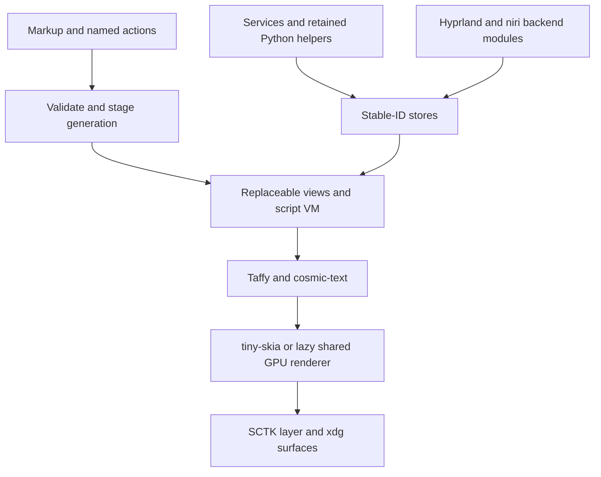

# ADR 0001 — A bounded CPU-first, interpreted shell experiment

Date: 2026-10-13. Status: **approved 2026-10-13, with the following owner amendments**.
Scope: Bead framework + GPL Nacre Shell experiment, not deployment.

## Owner amendments (supersede the research options below)

- Repository public by explicit request. Feature 1 authorized; stop after each feature.
- CC0-1.0, 0BSD, Unlicense, MIT-0 added to Bead's permissive licenses; notify eligible.
- niri-ipc is used in a GPL nacre-shell adapter behind Bead's neutral interface,
  beginning with compositor IPC in Feature 5. Do not reimplement niri's protocol.
  GPL dependencies are allowed in nacre-shell; libmpv uses that boundary later.
- cargo-deny in CI replaces new manual/generated ledgers. FEASIBILITY entries
  begin with 3–5 plain-language lines, a small table, under about 40 lines.
- Normal system build dependencies allowed; list installations. No additional
  isolation tooling. Use both nested Hyprland and niri for Feature 1.
- Feature 2 must stress real-size/scale/refresh animation with rounded corners,
  shadow, lots of text/color emoji and damage tracking. Report p50/p99, CPU and
  loaded-font PSS; warn about CPU pacing failure before Feature 3.

## Approved decision

Proceed through Feature 3/Gate B with SCTK, tiny-skia, cosmic-text, Taffy and a
small typed markup format plus optional Luau through mlua. Rust owns durable
stores, services and reload transactions. Add a lazy shared GPU renderer only
when a matched Nacre primitive/animation/effect test justifies it; first eligible
alternative is femtovg/wgpu. Vello was measured and remains an alternative, but
its first-run allocation is a concern. No full-shell rewrite commitment is implied.

This is assembled rendering/text/layout, with Bead's work concentrated in state,
reactivity, markup, reload, input/lifecycle and service/backend integration.
Taffy computes layout; cosmic-text shapes/layouts text; tiny-skia draws primitives.
Do not implement replacements for those engines. Missing shadows/effects must
use suitable existing permissive functionality, cached assets, a GPU alternative
or an explicit parity limitation, rather than silently expanding Bead into a new
renderer project.

## Evidence

- Audited Nacre: 224 QML files / 27,854 lines, 43 IPC handlers, 61 Process and
  31 FileView type references. Service QML alone is 9,572 lines. Exact command/
  binding/helper scope is in research 00 and the indexed JSON.
- SCTK covers the relevant client-side surface protocols, not controls/rendering.
  Backend capability differences are real (research 01/04).
- Completed blank-layer measurements are in
  [the renderer report](../research/02-rendering.md) and its generated numeric
  summary. A small CPU surface has a low baseline; GPU first/later-run costs differ.
  First/later-run differences do not establish fully controlled cold/warm cache
  conditions. No text/panel/video/IME/hot-reload performance was measured yet.
- Slint, libcosmic, niri-ipc and published Hyprland protocol bindings have licenses
  outside the allowed framework dependency set. Native video also needs a boundary.
- Prior art confirms that a shell without Qt must still provide control/input/
  service/lifecycle machinery. Noctalia's advertised memory and source size are
  not verified estimates of our full-parity cost.

## Intended components and ownership

Use a Cargo workspace. Create crates only when their feature requires them;
avoid empty architectural crates before they provide a useful tested boundary.

| Boundary | Owner and responsibility |
| --- | --- |
| bead-core | Stable-ID/schema stores, action queue, batched reactive dependencies and diagnostics |
| bead-wayland | Connection/event loop, output/seat/surface lifecycle, layer/xdg/lock/focus/scale protocols |
| bead-render | Existing renderer/text integration, shared/bounded resource caches, backend-neutral drawing needs |
| bead-ui | Typed markup AST/source spans, store/action references, Taffy wiring, controls/input, staging/swap |
| bead-services | Shared bus/process/helper client abstractions, bounded event publication and reconnect |
| bead-backends | Neutral compositor API; only modules here construct native compositor transport/actions |
| nacre-shell + shell/ | GPL application stores/behavior/layout/assets, existing helper invocation, GPL-only video adapters where required |

Feature 1 should introduce only the minimum useful framework surface crate and
shell executable. Phase 0's Cargo member is a throwaway measurement spike, not
these production modules. Every crate sets publish=false. Framework crates are
MIT OR Apache-2.0; shell and Nacre-derived UI/assets retain GPL-3.0 terms.

No generic widget calls hyprctl, niri native actions or compositor-specific JSON.
The contract mirrors both compositor-contract.json's declarations and the
runtime facade in NacreCompositor.qml/compositor.py. Capabilities prevent a
Hyprland-only feature from becoming a fake niri guarantee.

## Dependency license decisions

The exact published versions/release dates and source pins are in research
ledgers. Bead's allowed SPDX choices are MIT, Apache-2.0, BSD, Zlib, ISC and
Unicode; choose an allowed arm of an OR expression and retain notices. Check
AND expressions, native libraries, bundled sources, assets and enabled features.
A permissive wrapper over a non-permissive native library does not satisfy this
policy. Package metadata is evidence, not a complete legal certification.

| Dependency family | Proposed use / license decision |
| --- | --- |
| SCTK 0.21.1, wayland-client/protocols/wlr, calloop | MIT; eligible. Use toolkit-compatible dependency versions, not duplicate latest versions blindly |
| tiny-skia 0.12.0 | BSD-3-Clause; first renderer |
| cosmic-text 0.19.0 / swash / fontdb | MIT/Apache or eligible constituent licenses; enable audited CPU raster/font features; font assets separate |
| Taffy 0.15.0 | MIT; layout engine, no own layout implementation |
| mlua 0.12.2 + bundled Luau | MIT; bounded candidate VM, no arbitrary side effects during staging; exact transitive/native audit before adding |
| image 0.25.10, resvg/usvg 0.48.1, freedesktop-icons 0.4.0 | MIT/Apache or MIT; codec/theme/font asset scope audited separately |
| zbus 5.19.0, serde/serde_json, Tokio, rustix | MIT/Apache options; bus/process/transport/watch foundation; exact lockfile/feature audit required |
| PipeWire Rust 0.10.1 + native core client | MIT; exclude separately licensed compatibility/plugin libraries from framework link graph |
| AccessKit 0.25.1 / Unix 0.24.0 | MIT/Apache; check AT-SPI/transitive selected backend, implement semantics/action routing |
| xkbcommon Rust/native | MIT; use SCTK-compatible feature/version, not unnecessary duplicate binding |
| femtovg 0.27.0 / wgpu 30.0.1 / Vello 0.11.0 / Parley 0.12.0 | MIT/Apache; optional measured alternatives, not all eagerly linked/initialized in production |
| Slint/interpreter 1.18.1 | GPL/custom/commercial; excluded from Bead |
| libcosmic pinned source | MPL-2.0; excluded from Bead |
| niri-ipc 26.4.0 | GPL-3.0-or-later; use the crate in a GPL nacre-shell backend adapter behind the neutral Bead interface |
| wayland-protocols-hyprland 1.2.0 | LGPL-3.0-only; excluded. Audit/generate official permissive XML bindings independently where needed |
| notify 8.2.0 | CC0-1.0; eligible under owner amendment |
| libmpv2 6.0.0 / native mpv; GStreamer native | Non-permissive wrapper/native terms; GPL shell-side frame provider or separate process, never default framework dependency |

Phase 0's locked spike has a metadata audit of every resolved package (including
non-Linux target dependencies), in [spike-dependencies.json](../research/spike-dependencies.json).
No disallowed package was found in that graph. That audit does not extend to
future text/script/service crates that have not been added or to all native
libraries on the machine. Add a lockfile audit as each real dependency arrives.

## Reload and state invariants

The full transaction is in research 03. State never lives only in a view/VM.
Explicit stable IDs keep panel openness, inputs/selection/composition, scroll
anchors and window geometry. New schemas/defaults/migrations are staged against
a read-only snapshot; a bad candidate cannot mutate old stores. Domain list IDs
remain stable across reordering, unlike array indices.

Read/hash a consistent complete dependency graph; parse/type-check all changed
files and dependent bindings/assets; validate IDs/cycles/action signatures; stage
views/resources/isolated VM; swap only the newest complete generation on the UI
thread. Revalidate state revisions before applying staged migrations. Failed
parse/type/script/resource preparation keeps the old generation, with a Rust-owned
diagnostic overlay containing file/line/message. A successful fix clears it.
Old subscriptions and generation-tagged async work are canceled; services retain
their own lifetime. No side-effect request is replayed after a reload/worker crash.

Atomic means **one in-process generation/state transaction**, not guaranteed
simultaneous presentation on every monitor. Device loss, compositor loss and
runtime side-effect failures are separate failure modes; a syntax-error promise
cannot guarantee continuity after the GPU/compositor itself has failed.

## Rejected/deferred alternatives

- Slint would reduce language/control work and best resembles QML, but it fails
  the dependency policy. Do not misdescribe royalty-free as permissive licensing.
- Pure-Rust iced/Xilem/Masonry is an eligible fallback if language/control work
  becomes disproportionate. Ordinary compile loops and experimental hot patching
  do not meet the all-files/state/error-recovery promise without more proof.
- Dioxus/Blitz can supply familiar markup and native layout, but DOM/CSS/runtime
  breadth and shell surface integration may cost more than the small format.
  Subsecond data-layout migration remains a particular risk.
- Rhai is a simpler pure-Rust script embedding fallback. Do not switch on aesthetic
  preference; compare binding latency, memory, diagnostics and failure isolation.
- Eager Vello or full Skia as default would choose complexity/cold cost before
  proving necessity. GL femtovg and Skia remain unmeasured; no invented savings.
- A giant generated Rust translation of all QML and a new renderer/shaper/layout
  engine are rejected. They would delay the core feasibility question.

## Top risks, ranked by current evidence

1. **Tooling/control/input scope:** Qt quietly supplied controls, editing, IME,
   accessibility and effects. Cheapest proof: one real Nacre panel with text/input,
   then Feature 3 reload and Feature 4 IME/a11y before service-rich parity.
2. **Reload correctness:** arbitrary scripts, schema changes and stale callbacks
   can leak side effects/state even with stable IDs. Proof: invalid multi-file
   candidate + repeated reorders/edits under live service events.
3. **Memory/bandwidth tradeoff:** a blank CPU bar is cheap, but full-output double
   buffers/animations can dominate. GPU first-run state can erase gains. Proof: matched
   Nacre visual scene and a real-sized animated panel on one/two outputs.
4. **Backend capability parity:** niri workspace indices, positioning, release
   shortcuts, capture/blur are different. Proof: same neutral action/state fixture
   on both compositors; explicit unsupported errors.
5. **Remaining work/license boundaries:** video, markdown, notifications/tray and
   panels need more than transport crates. Proof: Gate C bar + panel, then measured
   pace/remaining estimate at Gate D after launcher. No full-parity deadline now.

## Proposed gates and kill criteria

Thresholds below are proposed experiment budgets, not measured guarantees or
owner-approved requirements. A miss must be recorded; one focused adjustment is
allowed, then recommend adjust/stop rather than hide or indefinitely tune it.

- Feature 1: both compositors, all outputs, clean exit and no daily-shell changes.
  A required protocol unavailable with no compatible fallback is a blocker.
- Feature 2: text/fallback/emoji/SVG/icon/primitive parity scene; no unsupported
  visual requirement concealed. Choose a renderer from numbers. Default cold
  memory repeatedly worse than equivalent QML by >10% is a concern/adjust trigger;
  it cannot be excused by reporting only warm-cache runs.
- Gate B: valid reload p95 <100 ms for the small panel, state/error recovery over
  100 cycles and no accumulating subscriptions/resources. A reproducible state
  loss, side-effect leak or old-view replacement on invalid files is a blocker.
  >250 ms p95 after focused adjustment or a language/control explosion merits stop.
- Feature 4: animated UI meets output frame budget (16.67 ms at 60 Hz), with
  p95/p99 and missed-frame rate; IME/basic accessibility must work. Provisional
  matched-pacing concern threshold: p95 frame interval >10% worse than QML, or
  missed-frame rate >1 percentage point above QML. Confirm workload/thresholds
  before measuring; CPU RAM savings cannot excuse a pacing failure.
- Gate C: bar + one panel on both compositors, including required services;
  proposed material-win budget is ≥25% PSS reduction, no worse idle CPU and no
  material pacing regression. Persistent >0.5% one-core idle CPU merits diagnosis;
  service behavior and helper totals must be counted consistently.
- Gate D after Feature 10: estimate remaining work from actual feature time/LOC/
  failures, explicitly including the most difficult unbuilt features. If pace
  and benefit do not justify full parity, recommend a limited shell or stop.
- Any disallowed framework dependency with no accepted boundary is a license
  blocker. If essentials require writing our own engine, stop/adjust architecture.

Owner approved Feature 1 with the amendments above. Stop after each feature;
formal recommendations still require owner decisions at Gates B, C and D.
