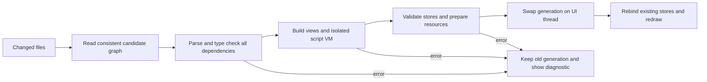

# 03 — UI model and transactional hot reload

Research date: 2026-10-13. Published versions/terms are pinned in
[crate-versions.json](crate-versions.json), upstream source revisions/dates in
[source-pins.json](source-pins.json). Source main may be newer than a published
crate: observations below name that distinction rather than mixing them.

## Recommendation to test

Use a deliberately small, typed declarative UI format, Taffy for layout, and
Luau through mlua for optional behavior. Rust owns services, state, transactions,
input routing and lifecycle. Markup contains structure/style, references to
named store properties, and named actions. It must not become a second QML with
arbitrary side effects inside property evaluation. Feature 3 tests this proposal;
the language and reactive engine are **not implemented** by this report.

This is the least proven part of the plan. A simple parser is easy; useful
diagnostics, dependency tracking, control behavior and safe reload are substantial
framework work. Do not claim that choosing Luau supplies those facilities.

## Compared options

| Option | State-preserving hot reload / error handling | Bindings and authoring | Performance/maintenance | License fit / judgment |
| --- | --- | --- | --- | --- |
| Slint markup + interpreter 1.18.1 | Compile a candidate at runtime, diagnostics before instantiation; app must own state and transfer/rebind stores into replacement components | Closest established QML-like markup; strong compiler diagnostics and documented APIs help agents | Existing controls/layout/renderers reduce work; custom Wayland platform integration still needed | Runtime is GPL-3.0-only OR royalty-free 2.0 OR commercial terms. **Excluded** by Bead's permissive-dependency rule |
| Own small markup + mlua 0.12.2 / Luau | Whole dependency graph staged and validated; candidate VM isolated, stores outside both trees/VMs; exact rollback under our control | Typed property references and named pure bindings; Luau familiarity is favorable but debug spans/integration are ours | Minimal stable core possible; language/control/reactive toolchain is a major ongoing cost | mlua MIT; bundled Luau MIT. Eligible after exact transitive/native audit; recommended experiment |
| Own markup + Rhai 1.26.1 | Similar transaction possible; scope/value migration still our job | Rust-like syntax, Rust registration APIs, bounded evaluator; smaller language ecosystem than Lua/Luau | Pure Rust build avoids a C++ VM; dispatch cost must be measured for the actual bindings | MIT OR Apache-2.0. Eligible fallback if Luau build/memory/integration fails |
| iced 0.14.0 | Application update/view model naturally separates data; widget-local state and subscriptions need careful identity/lifetime reconciliation | Rust type system/Elm-style messages are agent-friendly; recompilation is normal workflow | Controls/rendering exist; standard runtime/surface ownership must be adapted for a shell | iced MIT. Eligible component research; whole-framework adoption competes with Bead's file-reload goal |
| libcosmic source pin | iced-based controls and applet/surface facilities; no demonstrated whole-file transactional reload | Useful native controls and desktop integration | COSMIC-specific assumptions/dependency breadth; upstream fork integration is maintenance | MPL-2.0 at inspected manifest, not permitted by the user's license list; exclude from Bead |
| Xilem/Masonry 0.4.0 | Rust state separate from view descriptions, reconciliation available; not an interpreted file system | Type-safe Rust views; less markup ambiguity, but normal edits compile | Reuses Vello/Parley/AccessKit, valuable controls and lifecycle patterns; custom layer-shell runtime integration remains | Apache-2.0. Eligible, but renderer cost and compile/edit loop remain concerns |
| Dioxus 0.7.10 + Blitz DOM 0.2.4 | RSX/assets hot reload supports many structural edits; Rust Subsecond is experimental and does not automatically migrate changed data layouts | Familiar HTML/CSS/RSX aids agents; browser/CSS behavior exceeds our needed language surface | Native Blitz avoids a webview, but DOM/CSS/runtime are extra machinery and layer-shell needs adaptation | Dioxus/Subsecond/Blitz MIT OR Apache-2.0. Eligible alternative if custom language fails; not proven state-atomic shell reload |

Slint license distinction matters: our authored files can remain MIT/Apache while
linking a GPL toolkit in a GPL application, but that is not the same as Bead using
only permissively licensed dependencies. The royalty-free license is not MIT or
Apache and has attribution/platform restrictions. This disqualifies the proposed
dependency under the stated policy without claiming Slint is unusable in all
open-source applications. Checked
[Slint LICENSE](https://github.com/slint-ui/slint/blob/master/LICENSE.md) and
[published slint-interpreter metadata](https://crates.io/crates/slint-interpreter/1.18.1).

Slint upstream main's `internal/interpreter/api.rs` exposes Compiler diagnostics,
component definitions/instances, properties and callbacks; deprecated
ComponentCompiler examples must not determine the new implementation. Slint's
software/Skia/femtovg backends are licensed as part of its framework. Borrowing
the independently permissive renderer crates is different from copying its
backend/control implementation.

For Rust patching, the official
[Dioxus 0.7 hot-reload reference](https://dioxuslabs.com/learn/0.7/essentials/ui/hotreload/)
describes RSX/assets and an experimental `--hotpatch` path. Its documented
limitations include globals/initializers and dependency edits; the source pin is
newer than that 0.7.0 page, so workspace coverage at 0.7.10 is **not verified** by
the old page. The
[0.7 release notes](https://dioxuslabs.com/blog/release-070/)
explicitly say struct-field changes do not automatically migrate state. Cold or
incremental compile times are not reload latency; measure file-save to visible
presentation rather than quoting a demo's “instant” edit.

## Rhai versus Luau

mlua's source `state.rs` provides Luau sandboxing, VM memory limits and interrupt
callbacks. Luau offers a familiar scripting model and optional type annotations;
**the Rust embedding does not automatically run Luau's type checker**. Runtime
validation of bindings/action arguments stays Bead's responsibility. Check the
chosen compiler/debug-info path for exact file/line diagnostics. Official API:
[Luau embedding](https://luau.org/api/) and
[mlua](https://docs.rs/mlua/0.12.2/mlua/).

Rhai's source `api/limits.rs` supplies operation and expression-depth limits;
Engine registration/pure expression ASTs make it a viable simpler embedding.
It is pure Rust and has no JIT requirement. Language/tooling reach and developer
familiarity favor Luau; a reproducible binding benchmark and reload failure tests
must decide, not an unsupported belief that one interpreter is always faster.
See [Rhai Engine](https://docs.rs/rhai/1.26.1/rhai/struct.Engine.html).

For either VM: no arbitrary process/file/D-Bus access during candidate evaluation;
only bounded capability APIs after commit. Interrupt an infinite loop, bound
allocations, handle a runtime error without replacing the old generation, and
avoid VM-owned closures/data as durable state. Script side effects are queued
actions, never binding reads. Native Rust is not hot-patched in the headline
promise; editing compiled Rust still requires a rebuild/restart.

## State model and stable identity

Store keys are explicit component/application IDs with a schema version. A panel
store includes open/pinned/mode, input text, selection, scroll anchor/offset and
geometry; services have stable identities independent of any view generation.
Repeated lists use domain IDs, not list indices. Output identity is stable and
namespaced; detached window IDs are separate from output names.

On reload, views rebind to existing stores. Scroll offset alone is insufficient
when content changes: preserve a stable visible-item anchor plus offset, then
clamp to new geometry. Text focus/selection/composition state belongs to an editor
store, with an explicit policy for changed/removed fields. A removed view does
not erase the store immediately. Cleanup only when its ownership expires, with
bounded retention and a documented reset action. “Stable IDs preserve state” is
not proof unless reorder/remove/reinsert cases are tested.

## Reload transaction

1. Coalesce writes/atomic renames into a monotonically numbered reload request.
   Record hashes of the complete import/asset graph; read again if a file changes
   while loading. Discard stale completed jobs. Do not apply one file while its
   changed dependency is still invalid.
2. Parse all changed files and revalidate their dependent graph, resolve imports,
   schema/types/enums/assets, duplicate IDs, binding cycles and action signatures.
   Source spans survive into diagnostics: file, line, column and concise message.
3. Evaluate candidate pure bindings and initialize an isolated script VM against
   a **read-only state snapshot**. Stage new/default fields and migrations without
   changing live stores. Any exception/missing font/image/upload failure before
   commit keeps the existing tree.
4. Prepare layout/render resources without dispatching external actions. Reuse
   long-lived Wayland surfaces and device/font caches wherever possible. A changed
   surface topology cannot be made cross-output protocol-atomic; stage ownership
   and report a presentation limitation rather than hide it.
5. On the UI thread at a safe frame boundary, validate the request is newest and
   store revisions still match. Apply staged schema/default changes and replace
   the tree/VM/subscriptions as one in-process transaction. Commit no stale state.
6. New handlers read current stores. Cancel old generation timers/callbacks and
   tagged async work; service requests that should survive have store/service
   owners, never view owners. Drop old resources after outstanding frames finish.
7. On failure show a built-in Rust error overlay, independent of the broken
   markup; a subsequent valid reload clears it. Later script errors route to the
   same diagnostic path with a documented action rollback policy.

This requires a reactive dependency graph with dirty propagation and cycles
reported, explicit batching so intermediate values are not visible, subscription
lifetimes, typed values and deterministic action ordering. Taffy performs layout;
the renderer performs drawing. None of these crates is asked to serve as a
home-made text shaper or layout engine.

## Agent-friendliness proof, not a claim

The first language test should be a minimal panel using tokens/store references,
an action and a list. An agent should be able to modify structure/style, diagnose
an unknown property using the error output, and fix a binding cycle without
reading internal engine code. Supply a schema/reference and two small examples,
not a broad new language manual before it works. Diagnostic quality and source
locations are acceptance criteria, not polish deferred until parity.

## Feature 3 acceptance / Gate B

Feature 3 includes minimal real editing/selection, scrolling and Taffy layout
for the preservation fixture. Feature 4 expands those into general focus/gesture,
clipboard, IME and accessibility behavior; it does not postpone the state proof.

- Panel open, typed input/selection and scroll anchor survive 100 valid structural
  edits, including keyed list reorder and multi-file imports.
- Invalid syntax, wrong type, duplicate ID, cycle, missing asset and script loop
  keep the old view/state; fix clears error. No partial defaults/migrations leak.
- Service subscriptions/pending work remain correct; stale callbacks cannot
  mutate current views; memory does not grow unbounded over repeated reloads.
- Save-to-presentation latency measured over at least 30 edits, with median/p95
  and first/cold versus warm distinction. Proposed target: p95 under 100 ms for
  the small panel; >250 ms after a focused adjustment is a stop/adjust trigger.
- UI performance and matched QML memory/CPU are measured before any claim that
  the new model is cheaper. Render-heavy startup allocations count too.

**Verdict: concern.** Custom markup + Luau best matches the requested behavior
and license boundary, but it is an architectural hypothesis. If it cannot pass
Gate B cheaply, reconsider permissive Rust UI components or stop the experiment
before a full-shell port.
