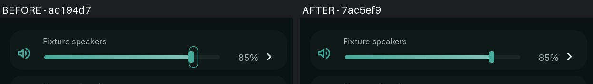

# B0103 — control input latency

Status: integrated by lead decision (417ac32, 60c82df, 7ac5ef9); required private measurements complete.
The measured nested presentation interval still exceeds the absolute latency target.

Control pointer positions previously queued independently behind every script/render acknowledgement.
Changing hover targets reprojected services and materialized the view; unchanged hover did so too.
Slider drawing used the topic value while its asynchronous action was pending. The default focus ring
also painted on pointer focus. The captures below separate those costs from the later presentation interval.

## Candidate

- Coalesce consecutive worker hover/drag positions, preserving all other event ordering.
- Skip unchanged hover. Host-selected `Session::with_local_feedback` stages pure hover/range feedback
  against the current model without service projection; actions, model wakes, release, and synchronous color edits retain projection.
- General numeric feedback: `preview_key`/`preview_value` on an action region and
  `ui.preview_value(key, authoritative)` in markup. `preview_inset` maps the track to its thumb centre;
  intermediate pointer positions move the knob continuously while action values retain their declared step. The kit slider uses this; service IDs stay at the edge.
- Hold continuous feedback during the gesture; release settles immediately to the declared action step,
  then allows 750 ms for topic convergence before reconciliation.
  `SceneSource::wakeup_at` drives deferred actions and expiry without a resident polling thread.
- Slider host actions keep their newest value at 34 ms intervals; release flushes the final target.
  A final flush is exempt from the continuous-drag limit. Absolute targets are never skipped based on stale topic equality.
- The legacy sound slider enqueues its PipeWire level without waiting for the worker reply; synchronous API callers retain their existing contract.
- Numeric range gestures retain capture outside their row, clamp at the endpoints, and cannot inherit
  another button's press. Tab focus does not change a value; arrow activation stays discrete and reaches the host adapter.
- Pointer focus retains input routing but suppresses the keyboard outline. Keyboard focus still shows it.
- `virtual-pointer.c` adds one-device nominal 250 Hz drag injection; intermediate events carry monotonic timestamps.

## Acceptance evidence

| Gate | Before | Candidate |
| --- | --- | --- |
| CPU hover → present, 2880×1800 / 1.5 | 32.20 / 32.45 ms | 32.29 / 32.48 ms |
| GL hover → present, same geometry | 32.12 / 32.34 ms | 32.30 / 32.50 ms |
| CPU drag → present | 782.63 / 1225.09 ms | 66.30 / 70.46 ms |
| GL drag → present | 935.15 / 1454.08 ms | 66.26 / 78.37 ms |
| Home first-key CPU median ≤8 ms, six pairs | 6.802 ms | 7.101 ms (pass) |
| Home idle/open/closed paired unreclaimable Δ≤+0.5 MiB, six pairs | paired reference | +0.037/+0.203/−0.014 MiB (median pass) |

Pointer rows are injection→presentation p50/p99. First-key and memory rows use medians. All four absolute latency gates (≤24.67 ms) fail.
Per-stage capture separates pointer receipt, handler/view, layout, bake, commit and presentation.
Private/nested timing does not establish physical scanout latency. QML parity uses the same private
geometry, presentation inputs and daemon fixtures. Missing measurements are not zeros.

## Checks and limitations

The first private arm exposed a fixture coordinate error (scene inset plus parent decorations); its drag result was rejected.
The corrected CPU control reproduces slider lag. Quiet timing uses presentation feedback without concurrent screencopy.
Explicit `--panel-renderer` selection now applies to named core panels; their default renderer policy is unchanged.
CPU/native-GL captures and six alternating Home pairs pass geometry/source/containment/quiet checks.
All twelve first-key CPU samples are below 8 ms. Closed-idle residency spread remains explicit below.

Validation is remote only. Full CI follows `.github/workflows/ci.yml`, in an Arch container.
The Arch replica needs Git snapshot metadata, Sway's `swaybg` helper, and Sway's file capability removed
inside the container (Docker omits that capability). No host configuration changed. New tool dependency: wlr-protocols.
The control's existing 5% action step is retained (the QML control declares a 1% step); pointer feedback is continuous
and release settles immediately to the declared step. Percentage readouts remain topic-backed until their echo.
Temporary product duplicates: none.

The 750 ms post-release reconciliation window is a candidate policy, not a proven service-latency bound;
delayed topic convergence beyond it remains an explicit validation risk.

## Measurement method and observed limits

Quiet timing uses a 60 Hz private labwc → niri chain at 2880×1800, scale 1.5.
The parent has server decorations disabled; pointer targets include the scene shadow translation.
All source hashes, source revisions, geometry, process SwapPss, host swap-in, guarded-cgroup and
full-window proofs are recorded per arm. The control is ac194d7 with matching opt-in timestamps
and explicit renderer selection; the candidate is 7ac5ef9. Both use the same control-view source
(60c82df). The pointer binary is built from 60c82df and injects one nominal 250 Hz drag device.
No live shell, audio state, desktop configuration or installed binaries changed.

Hover uses 50 panel entries interleaved with 50 neutral-area motions. The neutral motions do not
enter the panel surface and are reported as unmatched. Drag matching uses the continuous preview
value for the candidate and the first input in each 5% cell for the topic-backed control.
Every accepted timing sample joins a received input to its worker event, committed scene update
and matching `wp_presentation` feedback on the monotonic clock. Coalesced inputs are reported,
not counted as presented samples. Coverage counters describe selected visible updates, including quantized or
overwritten intermediate input; raw tool/receipt/worker counts are retained. Host-routed hover/slider actions have no Luau-handler marker;
that column is unavailable rather than zero.

CPU local hover view work falls from 7.20/7.62 to 0.06/0.07 ms, but panel commit→presentation
is 28.14/28.55 ms. Drag panel commit→presentation is 31.23/31.50 ms. Those measured intervals
alone exceed the absolute target. Callback-driven animation keeps one live frame callback;
removing that guard would risk pacing, buffer ownership and fallback presentation tracking.
This capture does not establish the physical laptop scanout latency.

The first 417ac32 CPU pair showed closed-idle anonymous +3.258 MiB. Follow-up full-smaps and
allocator snapshots show released panel graphs, stable live heap and retained free anonymous
arenas. The final matched CPU pair has lower candidate closed-idle anonymous residency
(23,088 vs 26,988 KiB); this single pair does not by itself establish repeatability.
No cache drops, allocator tuning or host memory changes were used.

QML source is bdc7c2ff6029df50bef9c22ad2f130c328a3cab4. Its logs expose no joinable input/
presentation markers, so its command acknowledgements and screenshot timings are not reported
as input→present latency. Paired evidence lists all remaining fixture and appearance gaps.
Private harness snapshots expire seven days after the measurements are reviewed.

## Per-stage timing

Cells are p50/p99 milliseconds. Host-routed inputs do not invoke a Luau handler; that stage is unavailable.
Control stages start at the earliest input in the displayed 5% cell. Its bake→accepted interval includes
intermediate work and waiting for topic feedback; it is not all paint CPU. Percentiles are not additive.

CPU; hover n=50 in both arms, drag n=11/36 control/candidate.

| Stage | Hover control | Hover candidate | Drag control | Drag candidate |
| --- | ---: | ---: | ---: | ---: |
| Input injection → receipt | 0.61/0.68 | 0.62/0.68 | 30.25/31.78 | 18.32/27.70 |
| Receipt → worker | 0.03/0.05 | 0.03/0.05 | 459.16/828.77 | 4.79/9.10 |
| Worker → view ready | 7.20/7.62 | 0.06/0.07 | 30.68/114.78 | 2.83/3.75 |
| View → layout | 1.40/1.46 | 1.65/1.80 | 1.26/1.53 | 1.37/1.64 |
| Worker bake | 0.26/0.27 | 0.31/0.39 | 0.28/27.15 | 0.23/0.27 |
| Bake → accepted scene | 0.49/0.55 | 0.61/0.83 | 216.74/333.59 | 0.42/2.87 |
| Accepted scene → surface commit | 0.74/1.03 | 0.85/1.27 | 1.12/12.24 | 7.29/10.92 |
| Surface commit → presentation | 21.47/21.88 | 28.14/28.55 | 0.66/31.53 | 31.23/31.50 |

GL; hover n=50 in both arms, drag n=12/36 control/candidate.

| Stage | Hover control | Hover candidate | Drag control | Drag candidate |
| --- | ---: | ---: | ---: | ---: |
| Input injection → receipt | 0.30/0.61 | 0.64/0.71 | 28.09/31.74 | 18.25/22.42 |
| Receipt → worker | 0.02/0.04 | 0.04/0.10 | 613.67/1065.88 | 4.64/16.57 |
| Worker → view ready | 8.74/9.54 | 0.11/0.15 | 23.74/130.24 | 2.76/4.07 |
| View → layout | 1.23/1.41 | 1.83/2.12 | 1.33/1.79 | 1.35/1.53 |
| Worker bake | 0.24/0.27 | 0.35/0.44 | 0.25/0.40 | 0.24/0.27 |
| Bake → accepted scene | 0.41/0.53 | 0.60/0.91 | 252.39/342.94 | 0.44/4.13 |
| Accepted scene → surface commit | 0.71/1.24 | 0.89/1.31 | 1.03/1.49 | 7.69/10.27 |
| Surface commit → presentation | 20.47/22.77 | 27.83/28.25 | 0.60/28.14 | 31.19/31.54 |

[Full sanitized timings, compose/submit wall and CPU, coverage and memory](evidence/0103/b0103-latency-memory.json).
Surface compose/submit is separate from the worker bake; GPU completion remains in the presentation interval.
Both candidate arms observed preview expiry at authoritative 85%, with no visible jump or return to origin.
Each sent 21 downstream volume writes over about 1.25 seconds, with minimum gaps above 46 ms.

## QML appearance evidence

[Paired states and residual gaps](evidence/0103/README.md) cover idle, open, hover, pressed and all four subpages.
[Open/close samples](evidence/0103/animation-contact.jpg) show the same right-edge direction. Relative to the
first screenshot, the last substantial change is around QML/Bead 250/325 ms opening and 200/150 ms closing.
The Bead fade is more visible. Sampling is about 25 ms with screenshot latency; this does not measure exact
animation duration from input or establish equivalent easing. The duration/fade difference remains a known gap.

## Control-page memory

Five samples after 20 seconds settled; one same-lease control/candidate pair per backend.
Unreclaimable = anonymous + shared memory + DRM + SwapPss. PSS and file-backed pages are information.
All figures are MiB; the laptop absolute cap is not a gate for this private desktop capture.

| Backend / phase | Control unreclaimable | Candidate unreclaimable | Δ | PSS control/candidate | File control/candidate |
| --- | ---: | ---: | ---: | ---: | ---: |
| CPU / idle | 21.826 | 21.455 | -0.371 | 41.008/40.649 | 19.182/19.194 |
| CPU / closed_idle | 27.041 | 23.240 | -3.801 | 45.315/41.423 | 18.274/18.183 |
| GL / idle | 21.795 | 21.795 | +0.000 | 41.122/41.148 | 19.327/19.352 |
| GL / closed_idle | 41.721 | 37.193 | -4.527 | 86.156/81.767 | 44.435/44.573 |

All four relative deltas pass ≤+0.5 MiB. DRM and SwapPss are known zero in these settled samples.
GL leaves more anonymous and file-backed residency after close in both builds; its matched candidate is lower.
Closed panel state confirms no resident panel, surfaces or panel-owned image payload. Full smaps and allocator totals
place the CPU high-water increase in freed anonymous arenas rather than retained live view graphs or stacks.

Matching 85% slider rows show the pointer outline change:

## Populated Home first key and memory

Three alternating ac194d7/7ac5ef9 pairs use the CPU renderer, identical 982cf2f frontend files,
320 fixture apps and four keys per arm. Both show 320 Home apps and 64 results for `a`; no blank/error
fallback was used. This measures UI process CPU through a matched presentation, not real-engine ranking/RPC.
First keys are control [7.018, 6.824, 7.123] and candidate [7.192, 7.023, 7.179] ms; medians are
7.018/7.179 ms (+0.161 ms), with every sample below 8 ms.

Five memory samples follow 20 seconds settled in idle, open and closed phases. Median paired
unreclaimable deltas are +0.023/−0.188/+0.012 MiB, within +0.5 MiB. Closed paired deltas are
[+2.496, −1.191, +0.012] MiB: the spread is substantial, almost entirely anonymous writable mappings.
Every arm logs worker/raster/SHM retirement and zero retained panel image bytes. These observations
support allocator or mapping residency variation, but do not alone distinguish free from live heap.
Three additional pairs repeat the same workload, reading allocator totals only after the closed samples.
Their closed paired deltas are [−0.039, +0.035, −1.352] MiB. In-use heap differs by only
11–31 KiB per pair; tracked cache bytes differ by about 3.2 KiB. All panels are nonresident.
Sequential smaps snapshots still vary by over 1 MiB in both directions while heap/cache totals stay close.
This supports allocator-owned mapping residency variation, not retained live view resources; it does not
prove every extra page was free or retroactively identify the original outlier's exact allocation.

Across all six same-workload pairs, first-key medians are 6.802/7.101 ms (control/candidate), and
idle/open/closed median paired memory deltas are +0.037/+0.203/−0.014 MiB. These pass the relative gates;
the original +2.496 MiB closed outlier remains disclosed. [All twelve arms and samples](evidence/0103/first-key-memory.json)
preserve the primary and diagnostic runs separately, plus the combined summary.

An earlier attempt stopped on an optional open-state dump exceeding the command reply limit; that
arm was rejected and preserved privately. The corrected run omits this dump, retaining all CPU, source,
geometry, swap, DRM, containment and memory checks. No acceptance threshold changed.
