# B0133 native pairs

Private nested niri, 2880×1800 at scale 1.5. QML is left; Bead CPU is right.

| State | QML (left) | Bead (right) |
| --- | --- | --- |
| welcome-hero | [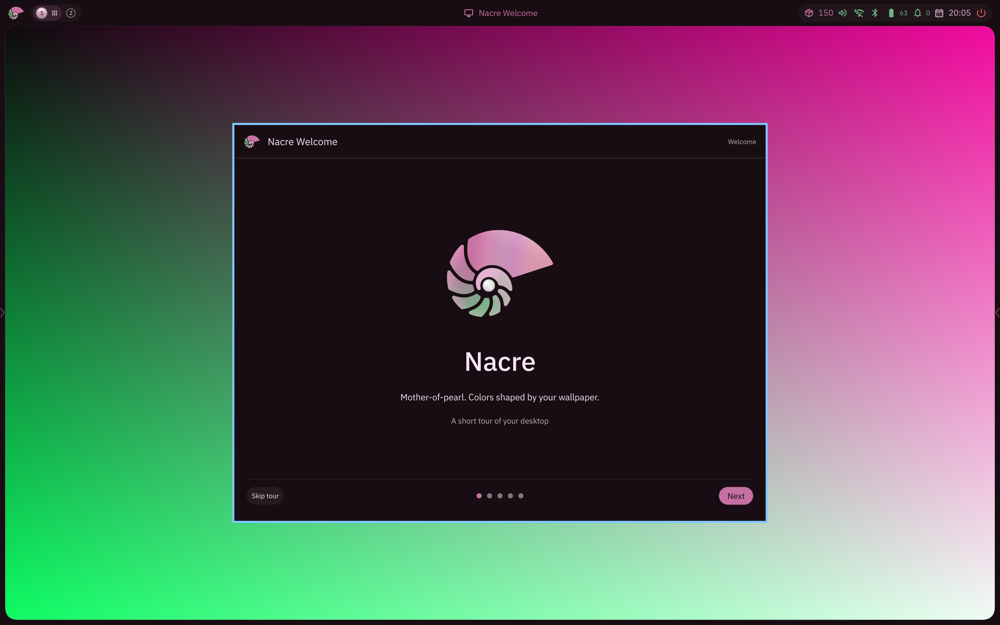](welcome-hero-qml.jpg) | [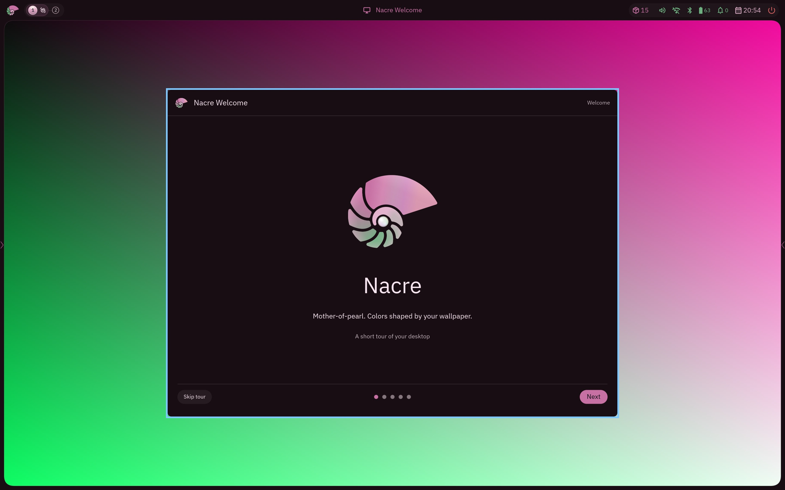](welcome-hero-bead.jpg) |
| welcome-colors | [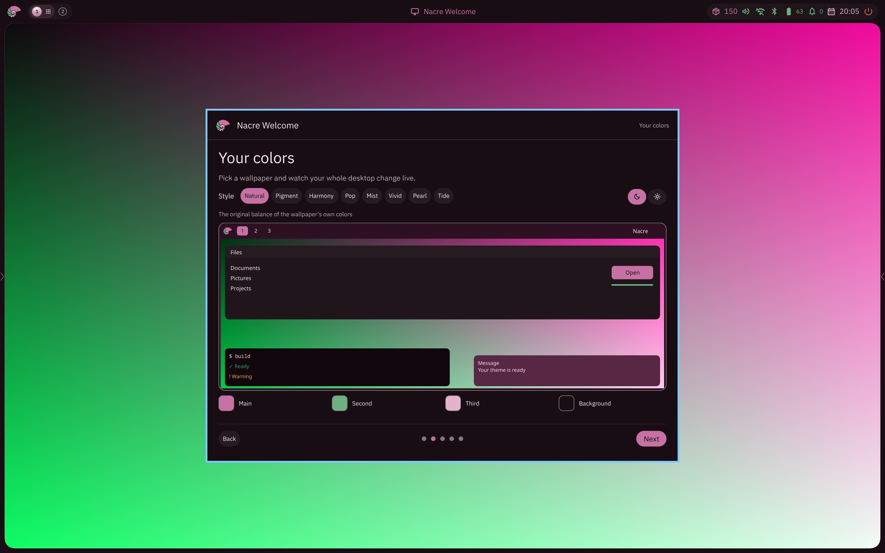](welcome-colors-qml.jpg) | [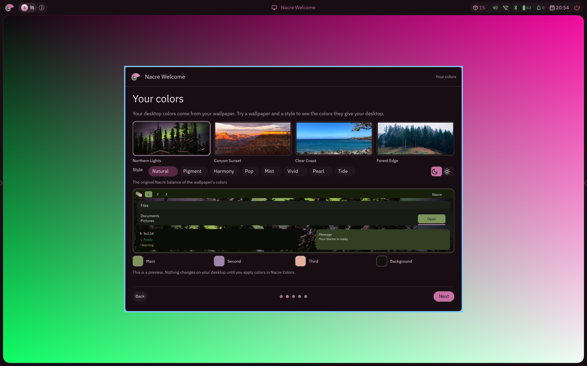](welcome-colors-bead.jpg) |
| welcome-shortcuts | [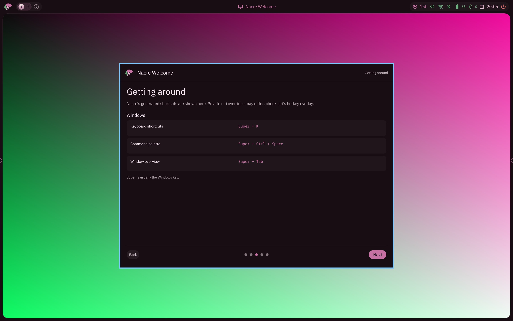](welcome-shortcuts-qml.jpg) | [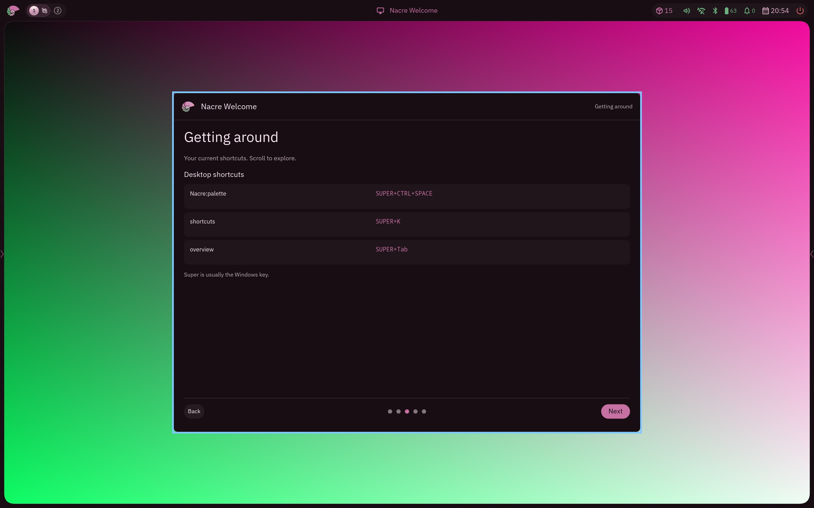](welcome-shortcuts-bead.jpg) |
| welcome-apps | [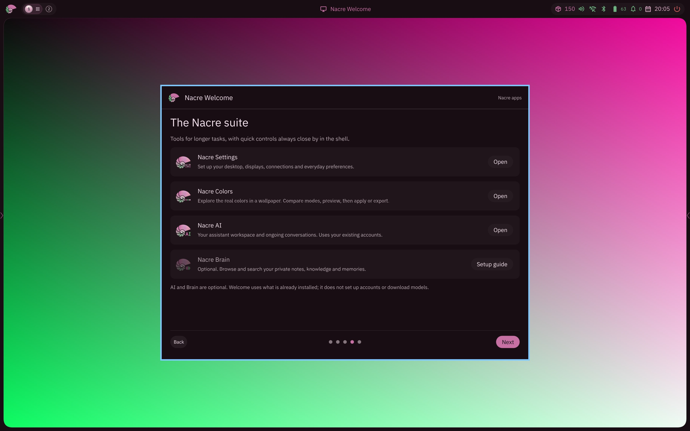](welcome-apps-qml.jpg) | [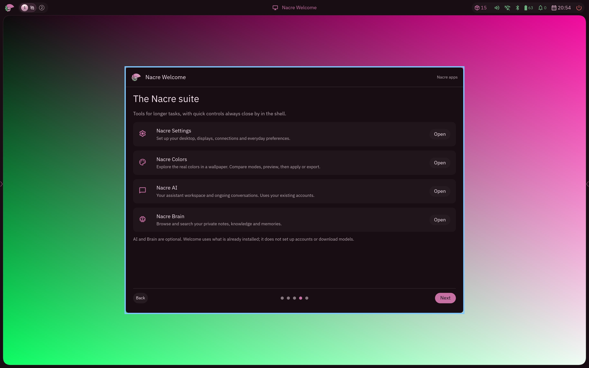](welcome-apps-bead.jpg) |
| welcome-ready | [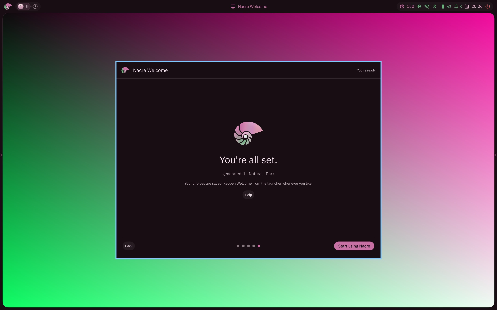](welcome-ready-qml.jpg) | [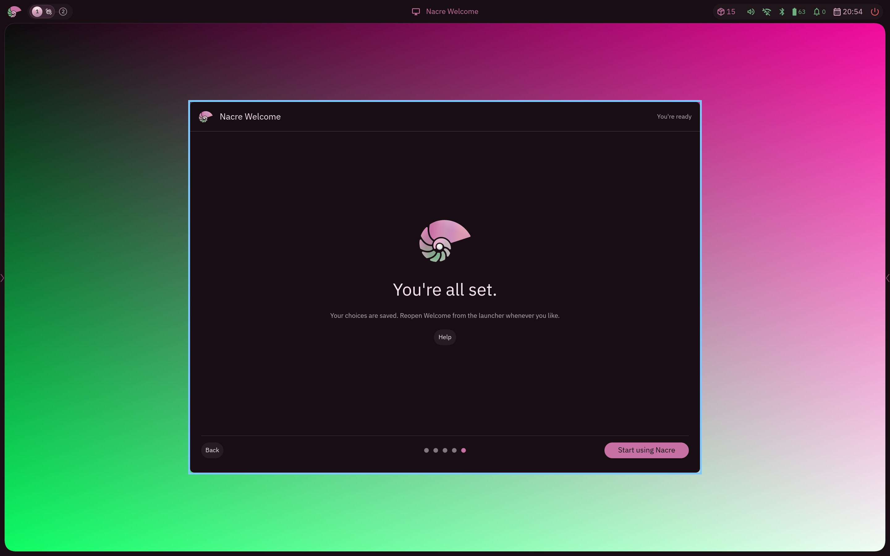](welcome-ready-bead.jpg) |
| welcome-help | [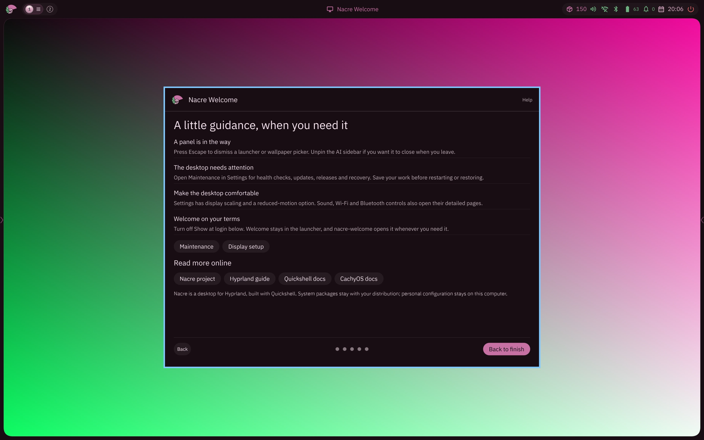](welcome-help-qml.jpg) | [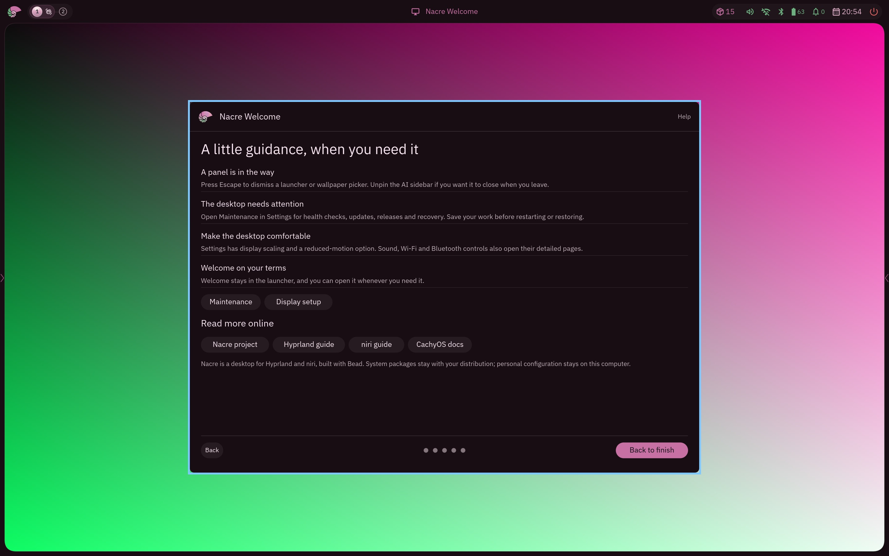](welcome-help-bead.jpg) |
| colors-app | [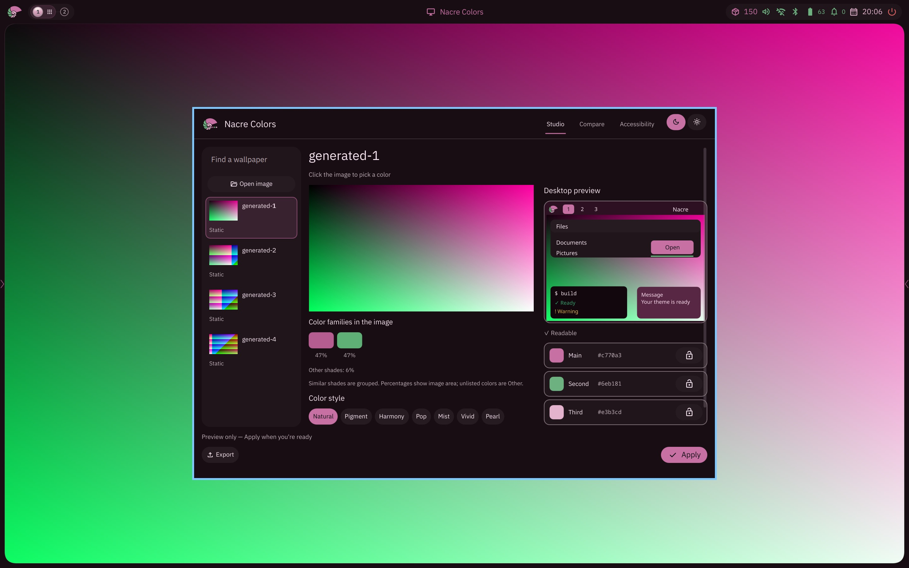](colors-app-qml.jpg) | [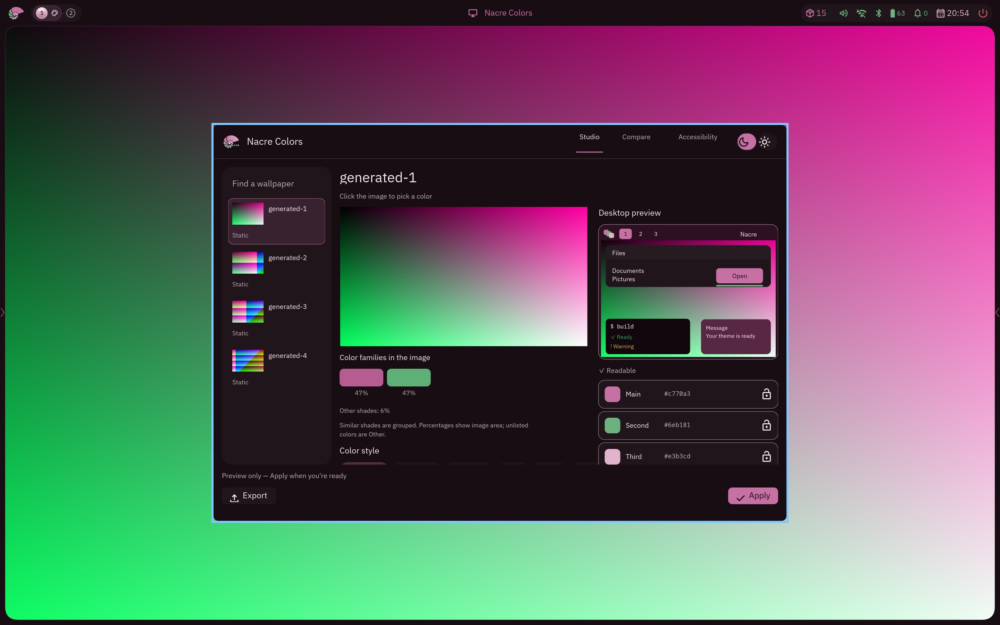](colors-app-bead.jpg) |
| settings-appearance | [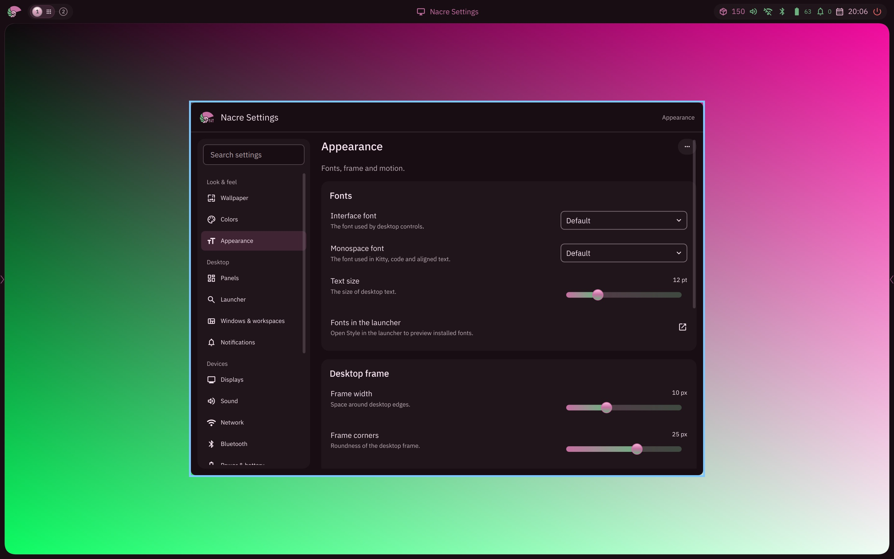](settings-appearance-qml.jpg) | [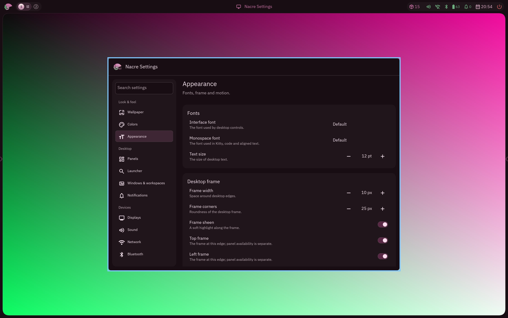](settings-appearance-bead.jpg) |
