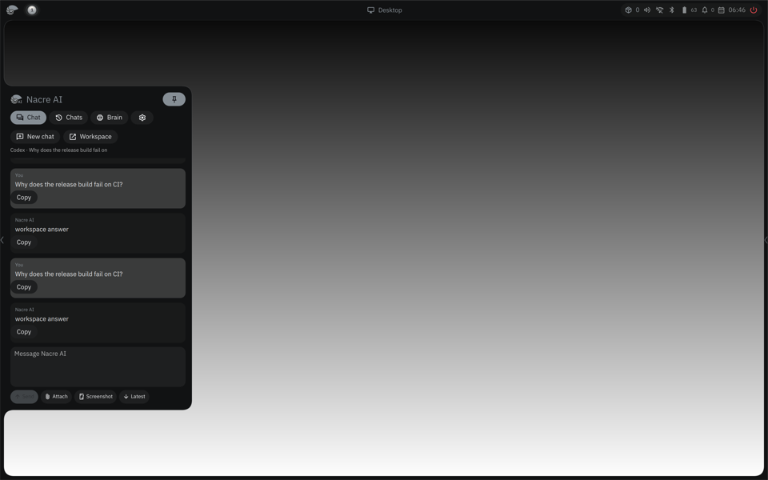
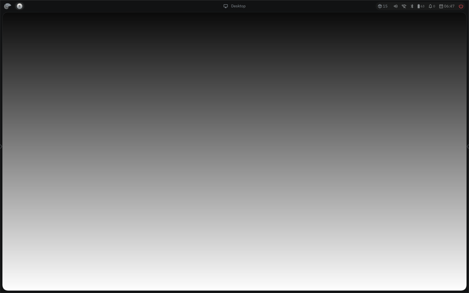
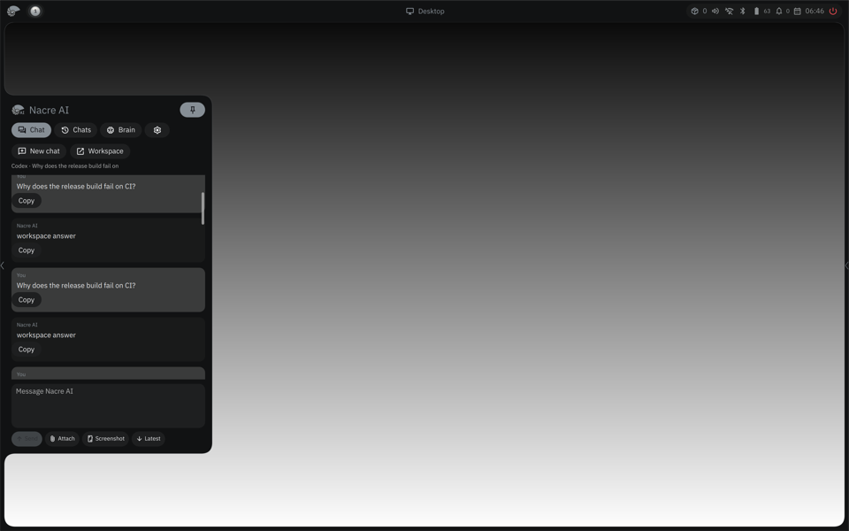

# AI chat pin and scroll reachability follow-up

This one-repeat source-pinned capture used the existing synthetic Codex provider, the published pin action and a click outside the sidebar before scrolling. QML state reports `leftPinned=true,left=true` after the outside click. Both Bead arms logged the expected pointer press/release but `bead.panel state` then reported `target_open=false`, `stores.chat.pinned=false`, and `dismiss_active=false`; the pin did not persist. The Bead capture's `pacing.json.errors` records that precondition failure.

The input point is geometrically valid: logical(240,650) logs as app-local(230,435), inside the 438×460.33 transcript viewport at top181.67. Transcript extent is2936.40 with bottom offset2476.07. Even so, both Bead child traces contain zero `AXIS_DELIVER` events and no input-time scroll changes, because the panel was closed before the gesture. This is a pin/reachability limitation shared by control and candidate, not a scroll-performance or candidate-regression result. QML received input but exposes no chat scroll-store or presentation trace here, so no QML reversal claim is made either.

| Screenshot | QML | Bead control | Bead candidate |
|---|---|---|---|
| Before |  |  |  |
| After |  |  |  |

Source hashes, exact offsets, pin-state results and the error are in [the compact trace summary](ai-chat-pinned-203.json). The Bead 84826 probe immediately before this stricter check is summarized in [launcher/AI follow-up](launcher-ai-84826.md).

This sidebar-pin probe remains a reachability diagnostic. The later standalone
`pearls.open ai` transcript probe reached the real viewport and is documented in
[the final transcript evidence](ai-pearl-transcript-203.md); it found and
validated the small-reader chat-follow correction without relying on sidebar
pinning.
