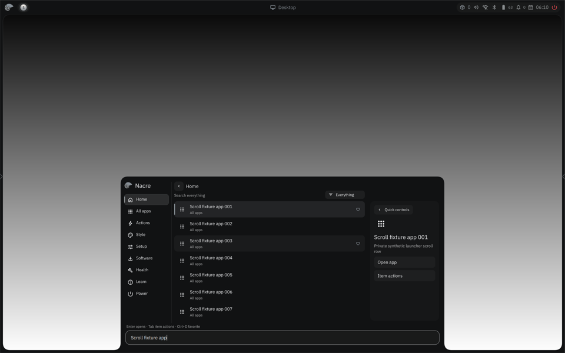
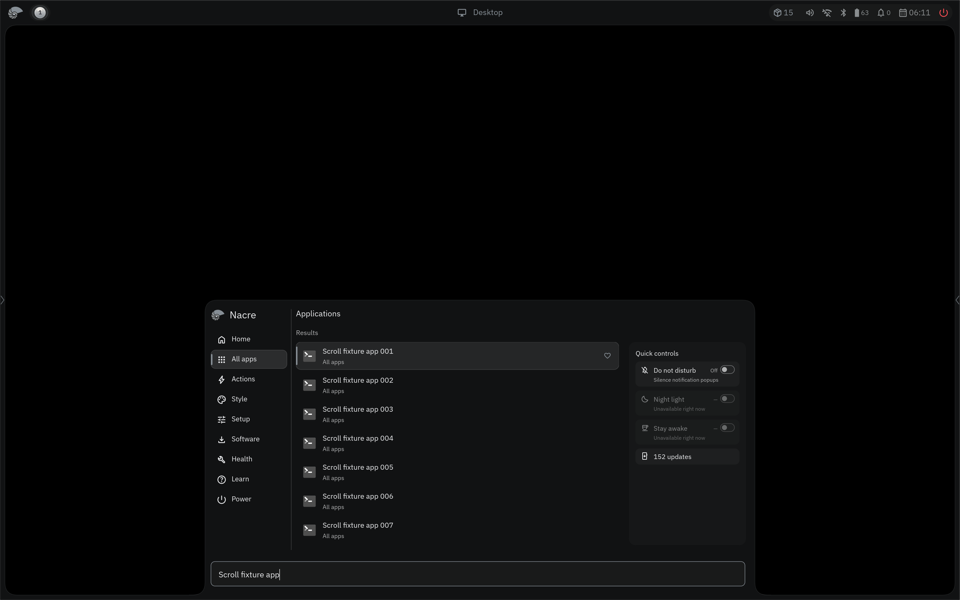
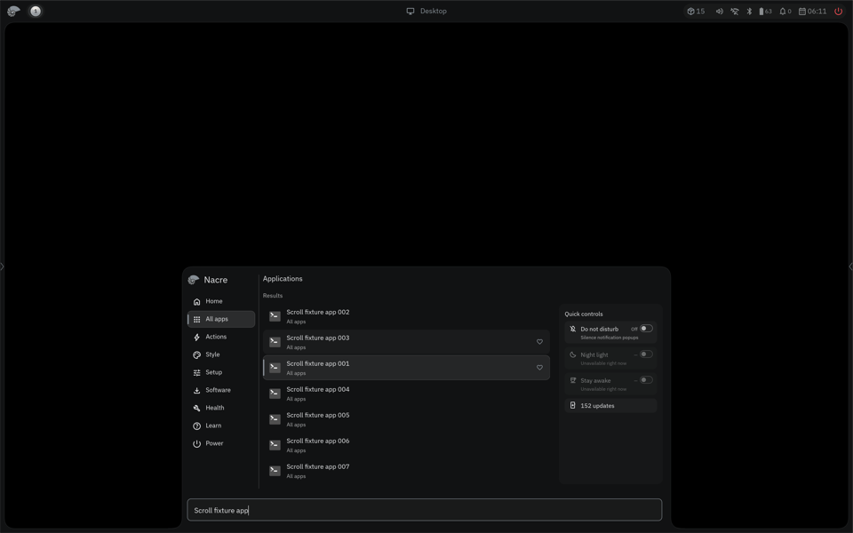
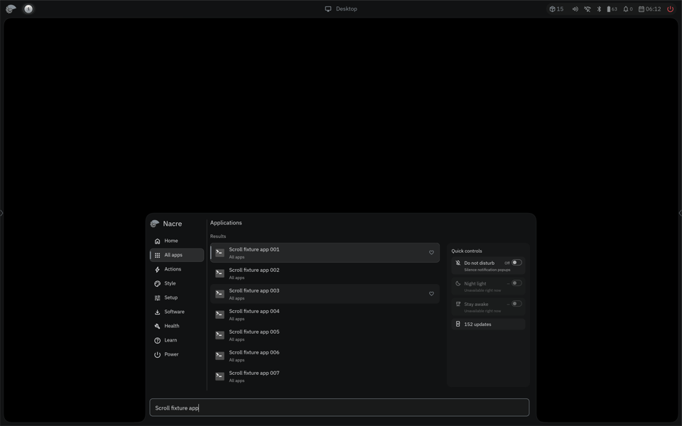
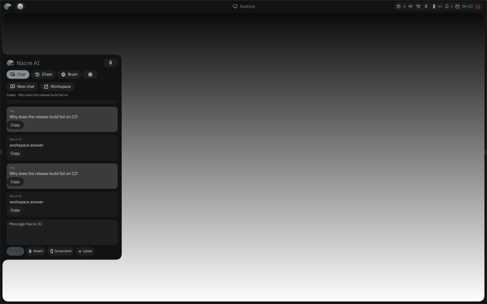
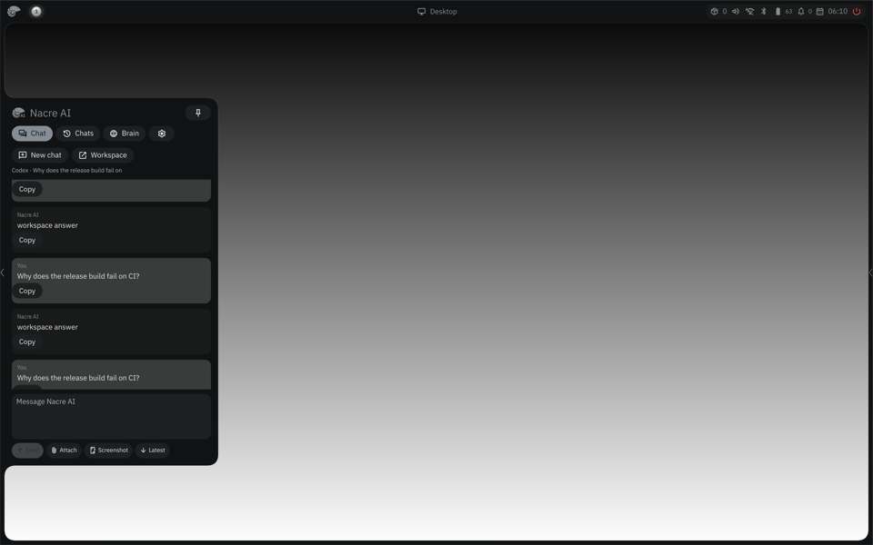
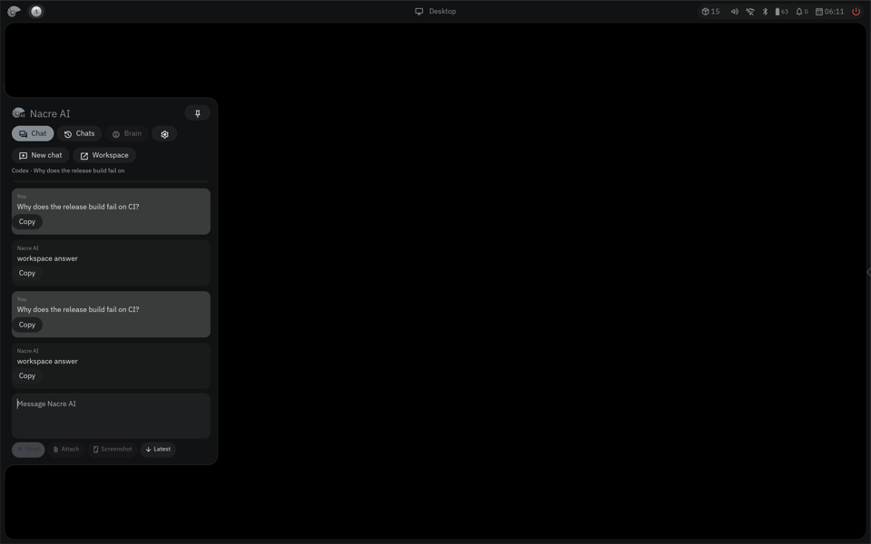

# Launcher and AI chat follow-up

One-repeat private nested capture compared QML, a clean-target control and candidate84826 at 2880×1800 physical / scale1.5. The QML export validator passed all754 files; swap was0 before and after, and all arms returned rc0 without UI errors. Control Bead used source `aac59abb…` and binary `e3545eefe0bd…`; candidate used source `84826bb5…` and binary `3db7085c909b…`. Both used the same synthetic launcher fixture and Bead shell tree `52a5777a…`.

The 81-row launcher input at logical(960,800) hit the visible result list. Control `launcher.scroll.y` stayed0 across160 events. Candidate `launcher.scroll.y` ranged0–560 with81 distinct offsets and a presented reversal: input→visible45.14ms, delivery→visible32.15ms. Candidate render p95 was1.263ms; all-gap presentation p95 was16.37ms (max100.37ms,91 missed-slot upper bound), with refresh prediction unavailable. This confirms the launcher scroll-dispatch fix is functional, while its one-frame reversal and cadence targets remain unmet. The 65aa/f327 launcher results are earlier diagnostics and are superseded by this run.

| State | QML | Bead control | Bead candidate |
|---|---|---|---|
| Launcher before / after |   |   |   |

The launcher screenshots show an inherited look-and-feel gap: QML presents Home/search/filter/selected-result detail over a gradient; Bead presents Applications without the top filter or detail pane over a solid black background. These screens use the same query and harmless synthetic rows.

AI-chat follow-up used the valid logical point(240,650), which logs as native-app point(230,435) inside transcript bounds top181.7/height460.3, width438. The earlier unpinned run showed control `chat.scroll` change while candidate stayed at bottom2476.07, but the panel auto-dismissed at the endpoint. A stricter203 run then pinned and clicked outside, queried panel state and preserved the generated provider stub hash. QML pin state is true; Bead control and candidate both fail to keep the sidebar open (`target_open=false`, `chat.pinned=false`, no dismiss animation). Neither Bead child received any AXIS_DELIVER events after closure, so this is a shared pin/reachability blocker, not a candidate scroll regression. See [the strict AI-chat state check](ai-chat-pinned-203.md); no Bead chat timing is accepted.

| State | QML | Bead control | Bead candidate |
|---|---|---|---|
| AI chat before / after |   |   |   |

Run ids: `b0135-launcher-ai-84826-20261026-01` and `b0135-ai-chat-pinned-84826-20261026-01`. Private fixture `sidebar_chat.rs` hash and generated Codex stub SHA were recorded in arm receipts. The pinned follow-up lacked a real pin-state query and should not be used to claim the pin persisted.
