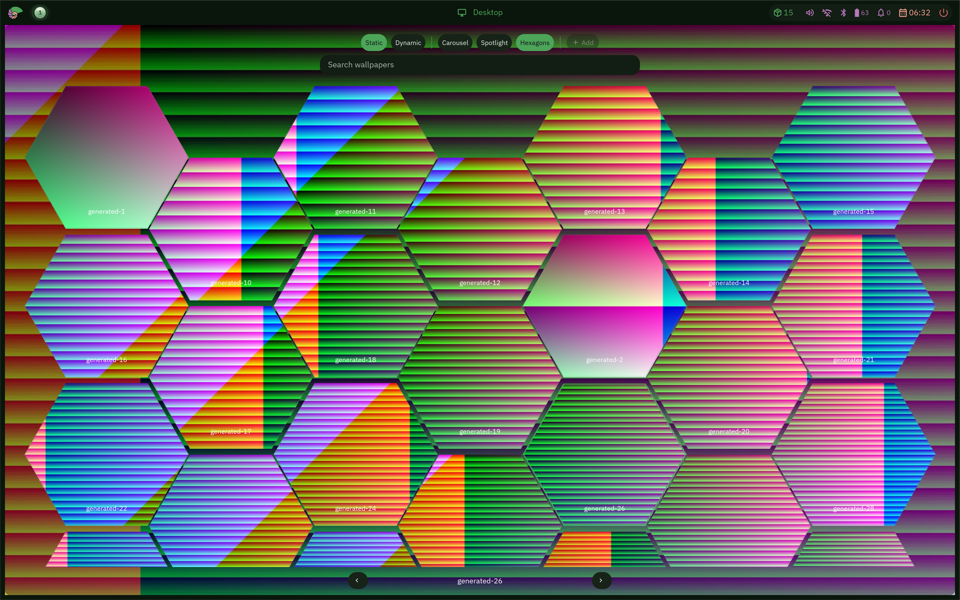
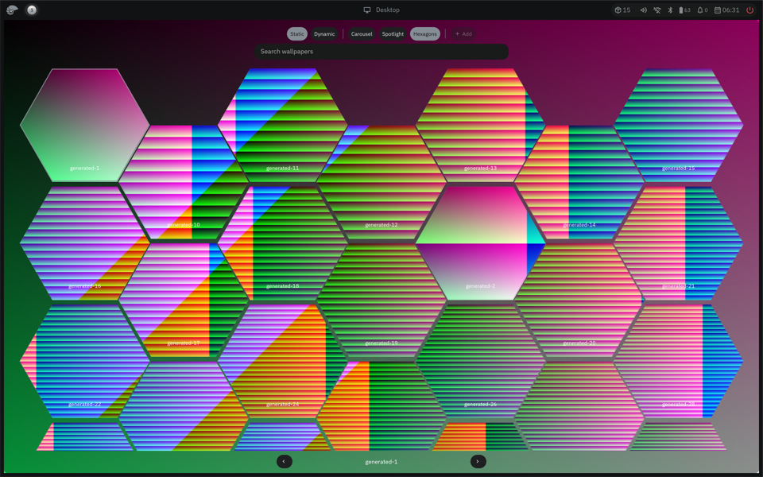

# Final 80-wallpaper default-GL same-shell reopen

One private Bead-only stress capture used 80 published wallpaper rows and the default Femtovg GL renderer at 2880×1800 physical, scale 1.5. Candidate source tree was `203f19d8764b0a41577eea8bed42481d88f26835`, shell tree `52a5777ab4f7a86a9ceaefb8d0024ad267170eca`, and Bead binary SHA-256 `952082d790fcf3b8951e5d97c0660c88f24c64e1fba3938a6f8bfffc2ca567de`. The private Nacre export validator passed 754 entries; host swap used was 0 before and after.

The same shell opened the hexagon grid, processed 160 finger events, closed for 12 seconds, then reopened for 12 wheel notches. Both input phases used the same runtime and fixture, but selected different wallpapers: `generated1` in the finger-after screenshot and `generated26` in the wheel-before screenshot. The wheel phase therefore includes a wallpaper composition change; it does not hold the selected image constant. `capture-safety-bead.json` returned 0; shell log had no `UI_ERROR`; both `extras.scroll` reversals joined to presented updates. This clears the previously failing 80-item same-shell reopen stress for this source snapshot.

| Phase | Global retained cache (used / 256 MiB) | Native GL images | CPU rasters | GL composite |
|---|---:|---:|---:|---:|
| Finger open, after input | 149,161,023 / 268,435,456 B | 70,874,698 B | 70,878,328 B | 4,921,408 B |
| Finger closed + 12 s | 165,430,221 / 268,435,456 B | 70,874,698 B | 70,878,328 B | 21,281,968 B |
| Wheel reopened, after input | 165,466,331 / 268,435,456 B | 70,809,021 B | 70,812,284 B | 21,281,968 B |
| Wheel closed + 12 s | 165,306,323 / 268,435,456 B | 70,809,021 B | 70,812,284 B | 21,281,968 B |

Process memory is PSS components plus DRM and SwapPss, sampled from the shell process; clean file-backed PSS is informational. Idle was 39,396 KiB unreclaimable (28,560 anon + 10,836 shmem + 0 DRM + 0 SwapPss; 38.47 MiB). Open phase was 493,073 KiB finger (172,776 + 10,941 + 309,356 + 0; 481.52 MiB) and 541,329 KiB wheel (164,820 + 21,065 + 355,444 + 0; 528.64 MiB). After close+12 s it was 425,769 KiB finger (133,884 + 10,941 + 280,944 + 0; 415.79 MiB) and 404,893 KiB wheel (136,832 + 21,065 + 246,996 + 0; 395.40 MiB). This is large observed renderer residency; it is not an always-on shell memory measurement or a physical-memory bound. Cache values are after-phase snapshots, not a peak during composition change.

Finger render p95 was 0.862 ms; input-to-visible reversal was 281.93 ms. Wheel render p95 was 0.739 ms; input-to-visible reversal was 559.72 ms. Whole-window presentation p95 was 184.27 ms (finger) and 1,045.43 ms (wheel), including edge/clamp/idle gaps; these missed-slot counts are upper bounds. Both `refresh_ns` predictions were 0, so this does not prove physical 120 Hz scanout or no dropped frames. The full [pacing JSON](203-reopen/pacing.json) and [cache owner samples](203-reopen/cache-probe.jsonl) preserve the component snapshots and joined frame data. The capture is a cache/reopen success, not a smoothness acceptance.

| Screenshot | Finger | Wheel |
|---|---|---|
| Before input |  |  |
| After input |  |  |

Run: `b0135-picker80-native-reopen-cacheprobe-203f19d8-20261026-01`; pointer SHA-256 `c8b201892a92bd2a116bd30e0fbde5e126be63a45b27486cfeb14411651147b7`; source validator manifest SHA-256 `69ac2783d98bddf93cdf1cabf1ed7ce821c1f6f97148327698c289d93d126e8f`.
