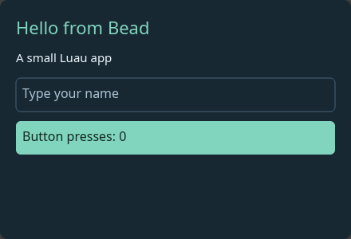
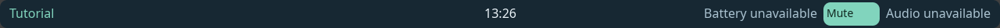

# Example gallery

Build the `bead` CLI first (see [Get started](../README.md#get-started)), then run commands from the repository root. Folder apps can be checked without a compositor; running them needs a Wayland session.

| Example | Shows | Check and run |
|---|---|---|
| [hello-window](hello-window/) | Basic window, text input, behavior action, computed counter. | `bead check examples/hello-window`; `bead run examples/hello-window` |
| [hello-bar](hello-bar/) | Minimal layer-shell bar with a title and fixed-width clock label. | `bead check examples/hello-bar`; `bead run examples/hello-bar` |
| [hello-status](hello-status/) | Workspace buttons and focused window title, desktop clock, battery, audio, media and power status, and a declared `uname` command. | `bead check examples/hello-status`; `bead run examples/hello-status` |
| [tutorial-bar](tutorial-bar/) | The [bar tutorial](../docs/tutorial/bar.md)'s bar: centered clock, battery, volume and mute action. | `bead check examples/tutorial-bar`; `bead run examples/tutorial-bar` |
| [bar-with-panels](bar-with-panels/) | Bar whose clock and volume buttons open Luau popup panels declared in `[panels]`. | `bead check examples/bar-with-panels`; `bead run examples/bar-with-panels` |
| [minimal-shell](minimal-shell/) | Standalone Rust host, stateful Luau window, bundled plugin, reload and CPU check. | `cargo run -p bead-minimal-shell --locked -- --check`; `cargo run -p bead-minimal-shell --locked` |
| [plugins](plugins/) | A third-party widget plugin with settings, in a richer package shape for hosts that define one. | Mounted by a host, not run alone; the [widget tutorial](../docs/tutorial/widget.md) shows the minimal plugin shape. |

## Screenshots

Captured with `bead run` in a headless sway session. Services the capture host did not have show as unavailable.

**hello-window**

**hello-bar**

**hello-status**

**tutorial-bar**

